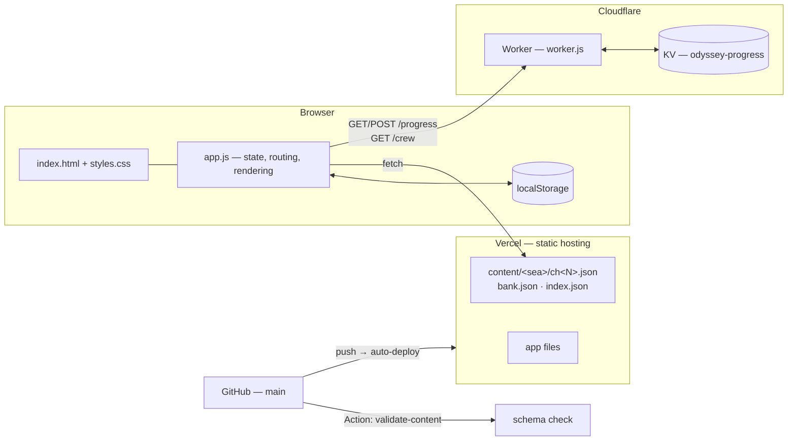
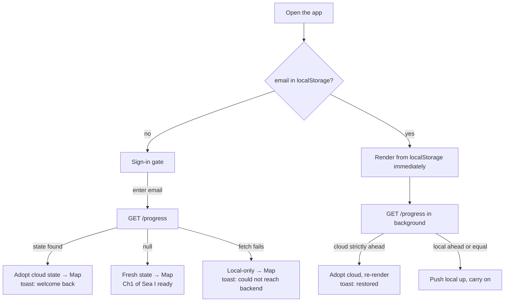
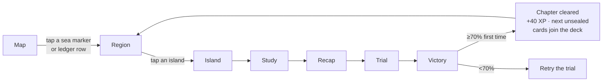
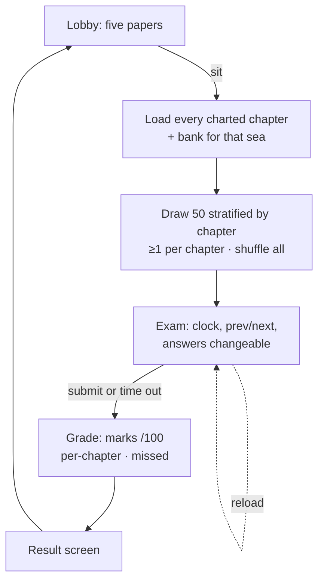
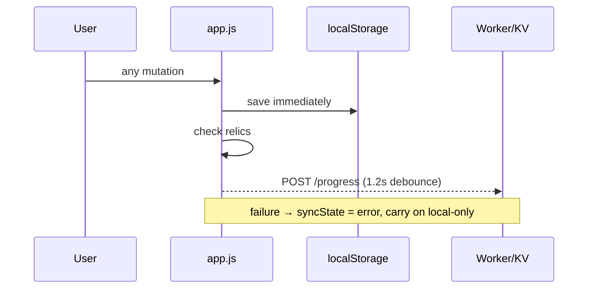
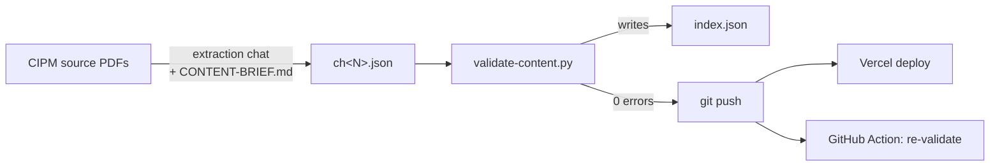

# Odyssey — structure and flows

A map of the app as it stands, for thinking about what to build next. It covers how the
pieces fit, what the app remembers, every screen and route, the user journeys through
them, the rules that drive progression, and where a new idea would plug in. It does not
cover chapter content itself — see `CONTENT-BRIEF.md` for that.

Snapshot: `app.js` ~2,100 lines, `styles.css` ~860, `content.js` 55, `worker.js` 94.
Five seas, 83 chapters. Live at sarahs-odyssey.vercel.app.

---

## 1. The concept in one paragraph

The CIPM Intermediate I syllabus is a sea voyage home to Ithaca. Each of the five subjects
is a **sea** with an Odyssey location; each chapter is an **island** on it. An island is
cleared by reading it, recapping it, and passing a **trial** (a 20-question quiz at 70%).
Cleared islands feed a spaced-repetition deck (**Athena's Counsel**) and the exam papers at
**Ithaca**. Progress earns XP, ranks and relics, and is kept in a dated **Ship's Log**.
Progress syncs across devices by email with no password. A **Crew** roster shows everyone
sailing.

---

## 2. System overview

Four moving parts, no build step anywhere:

| Part | What it is | Deploys by |
|---|---|---|
| **Frontend** | Static files, hash-routed single page, vanilla JS | `git push` → Vercel |
| **Content** | One JSON file per chapter, optional bank per sea, generated manifest per sea | same push |
| **Backend** | One Cloudflare Worker, one KV namespace | `npx wrangler deploy` |
| **Content CI** | `scripts/validate-content.py`, run locally and by a GitHub Action | — |

The frontend never needs the backend to *work* — it's local-first. The backend exists only
for cross-device sync and the crew roster.

---

## 3. Frontend architecture

**Render-from-state.** There is one state object `S`. Every screen is a pure function of
`S` plus a small amount of transient in-memory state, returning an HTML string that
replaces `#view`. Nothing is patched in place; every interaction calls `render()`.

**Hash routing.** `location.hash` is the only source of navigation truth. `parseHash()`
turns it into a `route` object; `hashchange` re-renders. Because the server only ever
serves `/`, there is no rewrite config anywhere.

**Two-phase render.** `render()` is synchronous and draws whatever it can from cached
data. `hydrate()` then fetches what the route needs (a chapter file, a manifest, the
roster) and calls `render()` again. Screens show a "loading" state between the two.

**View key.** Entrance animations must fire when you *arrive* somewhere, not every time
you click. `viewKey()` identifies a screen by route + stage + whether its content has
landed; the `.enter` class is applied only when that key changes. A 1.6s timer removes
the class regardless, so a browser that never runs the animation still shows the page.

**Event delegation.** One `click` listener on `document` dispatches on `data-*`
attributes (`data-go`, `data-pick`, `data-next`, `data-stage`, `data-rate`,
`data-mockstart`…). No per-element listeners survive a re-render, so none are attached.

**In-memory only** (lost on reload, rebuilt on demand):

| Name | Holds |
|---|---|
| `chapterCache` | `Map` of `'sea-N'` → chapter object, or `null` if fetched and absent. Bank files cache at `N = 0`. |
| `manifests` / `bankManifest` | Per-sea chapter titles and bank counts from `index.json` |
| `cardSession` | The current Athena's Counsel run: queue, done count, flip state |
| `crewRoster` | Last fetched roster |
| `celebrateFor` | Which chapter/paper just cleared, so the celebration fires once |
| `mockTimer` | The exam clock interval |

---

## 4. Data model

### 4.1 Configuration — `content.js`

Everything tunable lives here and nowhere else.

| Symbol | Meaning |
|---|---|
| `SUBJECTS` | The five seas: `id`, roman numeral, name, myth, port name, map x/y, `chapters` count |
| `ITHACA` | The sixth marker — the exam |
| `PASS_MARK` 70 | % needed to clear a chapter, or pass a paper |
| `CHAPTER_XP` 40 · `CARD_XP` 5 · `MOCK_XP_PER_CORRECT` 1 | The XP economy |
| `MOCK_QUESTIONS` 50 · `MOCK_MARKS_PER_QUESTION` 2 · `MOCK_MINUTES` 60 | Paper shape (clock unconfirmed) |
| `LEVELS` | XP thresholds per level, 15 entries |
| `RANKS` | Level names, Deckhand → Hero of Ithaca |
| `BADGES` | 12 relics, each a predicate over a summary of state |
| `EXAM_DATE` | Countdown target in Ship's Log |
| `WORKER_URL` | The backend |

### 4.2 Content — `content/<sea>/`

| File | Shape | Purpose |
|---|---|---|
| `ch<N>.json` | `{subject, subjectName, chapter, title, objectives[], study, recap, quiz[], cards[]?}` | One island. `quiz[i]` = `{q, opts[], correct, why?}` |
| `bank.json` | `{subject, source, questions[]}` | Exam questions not tied to a chapter. Only papers use it. |
| `index.json` | `{subject, chapters:[{n,title,questions}], bank}` | Generated by the validator. Lets the region and Ithaca lobby render without fetching chapters. |

Content is fetched lazily, once, and never bundled. Adding a chapter is adding a file.

### 4.3 Saved state — `S` (localStorage `odyssey.v2`, synced to KV)

| Field | Type | Meaning |
|---|---|---|
| `v` | 2 | Schema version. Older saves are migrated field-by-field on load. |
| `xp` | int | Total XP. Level and rank derive from it. |
| `startedOn` | ISO date | First day. Streak grid shows earlier days as "not sailing", not "missed". |
| `cleared` | `{'sea-N': {score, on, attempts}}` | Cleared chapters. `score` is the best run. |
| `pos` | `{'sea-N': {stage, qi, answers[], qOrder[], oOrder[][]}}` | Where you are in each chapter: stage 0–3, current question, answers as *original* option indices, and the shuffle permutations so a reload keeps the same order. |
| `titles` | `{'sea-N': title}` | Chapter titles seen, so grids render without refetching. |
| `studied` | ISO date[] | Every day something was completed. Streak derives from it. |
| `sched` | `{cardId: {due, ivl, ease, reps, last}}` | Spaced-repetition schedule per card. |
| `cardsReviewed` | int | Lifetime count, for the Scholar relic. |
| `perfectTrial` | bool | Any 100% trial, for the Perfect relic. |
| `relics` | `{name: ISO date}` | Relics found and when. Earned by state, so retroactive. |
| `mocks` | `[{on, sid, total, right, marks, maxMarks, pct, minutes, byChapter, missed[], reason}]` | Every paper sat, oldest first. |
| `mock` | `{sid, started, deadline, qs[], k, answers[]}` | A paper in progress. Wall-clock `deadline` so a reload resumes with time left. Absent when none is open. |
| `openWaters` | bool | Course mode. `false` = seas and chapters unlock in order. |
| `lastSea` | sea id | Where the ship sits in open waters. |

Everything derived — level, rank, streak, voyage %, chapter status, sea state, relic
eligibility, log entries — is computed from these on every render. Nothing derived is
stored.

### 4.4 Device-local preferences (localStorage, not synced)

| Key | Meaning |
|---|---|
| `odyssey.email` | Who's signed in on this browser |
| `odyssey.music` | Sound on/off — a room setting, not voyage progress |

---

## 5. Routes and screens

| Hash | Screen | Shows | Needs loaded |
|---|---|---|---|
| *(gate)* | Sign-in | Email prompt; shown whenever no email is stored | — |
| `#/map` | The Map | Pixel map, six markers, the ship, voyage %, next port, nudges, ledger | Next chapter's title; the deck (for the due-cards nudge) |
| `#/sea/:id` | Region | A sea's chapters as island cards with status; resume, seal note, deck summary | The sea's manifest (else every chapter, for titles) |
| `#/sea/:id/ch/:n` | Island | The four-stage chapter | That chapter's file |
| `#/counsel` (alias `#/cards`) | Athena's Counsel | Flashcard review with rating buttons | Every cleared chapter (cards derive from them) |
| `#/stats` | Ship's Log | Rank/XP, streak grid, seas progress, past papers, relics, the log, course toggle, sync panel | — |
| `#/crew` | Crew | Every navigator ranked by XP | `GET /crew` |
| `#/ithaca` | Ithaca lobby | Five paper cards, resume banner, past papers | Every sea's manifest |
| `#/ithaca/exam` | Paper | Timed exam, one question at a time, prev/next/submit | Every charted chapter + bank of that sea |
| `#/ithaca/result` | Paper result | Marks, per-chapter breakdown, what you missed | Same |

Navigation chrome: a top bar (brand, music toggle, level/streak or context) and, on
phones, a four-tab bottom bar — MAP · COUNSEL · STATS · CREW. On desktop the tabs move
into the top bar. Ithaca is reached from the map, not a tab.

---

## 6. User flows

### 6.1 Arriving

"Strictly ahead" = more chapters cleared, or equal cleared and more XP. A device that
worked offline never has its work overwritten by a stale cloud copy.

Sign-in is a user gesture, so it's also where the ambient music is allowed to start.

### 6.2 The voyage

Inside an island, a **stage rail** lets you jump back to any stage already reached.
Jumping into the Trial from the Victory screen starts a fresh attempt. `pos` remembers
exactly where you are — a reload mid-trial lands on the same question with the same
shuffled options.

**Trial mechanics.** Options are shuffled every attempt; question order is shuffled on
retakes. Answers are stored as original option indices, so scoring never depends on
display order. Each answer gets an immediate verdict — a varied affirmation when right,
the correct answer (plus `why` if the content has it) when wrong. Victory ends with
**What you missed**: every wrong answer, what you chose, the true answer, the explanation.

**Redo.** A cleared chapter can be sailed again from Victory. Only the best score is
kept; XP is never awarded twice; a failed retake leaves the chapter cleared.

### 6.3 Athena's Counsel

Cards come from cleared chapters — authored `cards[]` where the chapter has them, its quiz
questions otherwise. A session is every card due today. Flip (tap or Space), rate
again / hard / easy (or 1 / 2 / 3). Scheduling is a light SM-2: *easy* roughly 4 → 10 →
26 → 69 days, *hard* creeps, *again* resets and dents the ease. The buttons show the real
next interval for that card. Each rating is +5 XP and counts toward the streak.

### 6.4 Ithaca — the papers

One paper per sea, 50 questions × 2 marks. A paper draws from **every charted chapter
of its sea, cleared or not**, plus the sea's bank — so it can be sat as soon as the sea
has any content, and widens as chapters land. The deadline is wall-clock and saved, so a
reload resumes with the time you had left; expiry auto-submits. Submitting with blanks
asks you to tap again. Every paper is kept; Ship's Log trends the last six.

### 6.5 The course

Ship's Log → **The Course**. Two modes, stored in synced state:

| | Charted course (default) | Open waters |
|---|---|---|
| Seas | Open in order, each when the last is finished | All open |
| Chapters | Open in order within a sea | All open; the next in line still reads READY |
| The ship | First unfinished sea | Wherever you last studied (`lastSea`) |
| Switching back | — | Later seas re-seal; progress kept |

A sealed sea or chapter renders as sealed however you arrive — click, URL, back button.

### 6.6 Everything else

- **Crew** — `GET /crew` returns display names (email local part only), XP, chapters,
  last studied; ranked by XP; your row highlighted. Placeholder monogram sprites.
- **Switch navigator** (Ship's Log) — signs out, clears local state, back to the gate.
- **Music** — top-bar toggle; ambient loop, fades in/out, fetched only when on. 8-bit
  effects (right, wrong, tick, victory, fail, relic, level-up) synthesised in-browser
  follow the same toggle.

---

## 7. Progression rules

**Chapter status** — `done` if cleared; `ready` if it's the first uncleared in its sea;
otherwise `open` in open waters or `locked` on the charted course.

**Sea state** — `done` if every chapter cleared; on the charted course `current` if all
earlier seas are done else `locked`; in open waters `current` for the ship's sea else
`open`. Ithaca is `goal` until all 83 are cleared.

**XP** — 40 per first clear, 5 per card rated, 1 per correct answer on a paper. Never
farmable: retakes award nothing, papers take an hour.

**Level and rank** — `LEVELS` thresholds; `RANKS[level-1]`. Crossing a threshold toasts.

**Streak** — consecutive days in `studied` ending today or yesterday. Anything that
counts as studying (answering a trial question, rating a card, sitting a paper) marks
the day. The map warns when today is still blank.

**Relics** — 12 predicates over state, checked after every save. Earned by *state*, so
a navigator who cleared a sea before its relic existed gets it on next load. Dated,
toasted, hinted on hover.

**The log** — a dated timeline derived entirely from state: chapters cleared, seas
finished, relics found, papers sat, the day you set sail. Fills in retroactively.

---

## 8. Sync model

- **Local first, cloud second.** A write is safe the moment it happens; the cloud is
  eventually consistent by ~1.2s.
- **Keyed by email, no password.** Anyone who types an address reads and writes that
  progress. Deliberate tradeoff for study data on a small private roster; documented in
  the README and in the sign-in gate itself.
- **Last write wins** between two devices used at the same moment. The boot-time
  "strictly ahead" rule protects against a stale cloud copy overwriting fresh local work,
  not against genuinely concurrent edits.
- **Two device-local things never sync:** which email is signed in, and the music toggle.

---

## 9. Content pipeline

- The **validator** checks every chapter and bank against the schema, exits non-zero on
  any error, warns on fewer than 20 questions, notes chapters lacking `why` or `cards`,
  and writes each sea's manifest.
- The **Action** runs it on every push touching `content/` and fails on a broken file or
  a stale manifest. Vercel deploys regardless — it's a signal, not a gate.
- The **brief** (`CONTENT-BRIEF.md`) is the spec handed to the extraction process,
  including the quality rules derived from the September 2025 past paper and a
  paste-ready prompt.

**How a paper's pool is built:** every `ch<N>.json` in the sea that exists on the server
(cached `null` if not) plus `bank.json`, all quiz arrays concatenated, then a stratified
draw. The manifest tells the lobby the pool size without fetching any of it.

---

## 10. Backend

`worker.js`, deployed at `odyssey-progress-api.sarah-s-odyssey.workers.dev`, bound to KV
namespace `87d0a9dd26cc49de97261d41493d6f7a`.

| Route | Does |
|---|---|
| `OPTIONS *` | CORS preflight, `*` origin |
| `GET /progress?email=` | Returns the stored JSON, or `null` |
| `POST /progress?email=` | Stores the body verbatim; must parse as JSON; 200 KB cap |
| `GET /crew?email=` | Lists every `user:*` key, returns `{name, xp, cleared, lastStudied, you}` per navigator, sorted by XP. Never returns full addresses. |

KV key per navigator: `user:<email>`. Value: the whole `S` object. No other tables,
no indexes, no auth, no rate limiting.

---

## 11. Known limitations — the honest list

- **No authentication.** Anyone can read or overwrite any navigator by email. Roster
  makes addresses guessable (name = local part). Acceptable on a small private roster;
  not beyond it.
- **No rate limiting.** KV's free tier allows 1,000 writes/day; a hostile script could
  exhaust it and block real saves.
- **Concurrent edits** on two devices are last-write-wins.
- **No offline support / PWA.** The app is local-first but the shell and content still
  need the network on first load.
- **Exam clock unconfirmed.** 50 questions × 2 marks is right; 60 minutes is a guess.
- **Question quality in older content.** Business Administration's 300 questions predate
  the brief and carry the "correct answer is the longest option" tell (63%). Statistics
  chapters written to the brief don't.
- **Cached 404s.** A chapter file added while a tab is open stays "not yet charted" until
  reload.
- **Single level.** Intermediate II would need a level segment in content paths and
  state keys; not designed.
- **Crew sprites** are placeholder monograms.
- **Reduced-motion** is implemented but untested at runtime.

---

## 12. Where a new idea plugs in

**A new screen.** Four touches: a route in `parseHash()`, a `renderX()` function, a
branch in `hydrate()` for anything it must fetch, and a `viewKey()` case if it has
loading states. Nav tabs are in `index.html` (twice — top bar and bottom bar).

**A new kind of content.** Follow the bank pattern: a file per sea, a `loadX()` that
caches into `chapterCache` under a reserved chapter number, a validator branch, a
manifest field. The exam and review machinery then get it for free.

**A new field in saved state.** Add it to `freshState()`, add a migration line where
older saves are patched on load (three places: `loadLocal`, `signIn`, `refreshFromCloud`),
and it syncs automatically — everything in `S` does.

**A new relic.** One line in `BADGES`: icon, name, predicate over `badgeState()`, hint.
Retroactive by construction.

**A new sound.** One line in `SFX`; call `sfx('name')`.

**A new backend route.** One `if (url.pathname === …)` block in `worker.js`, redeploy
with `npx wrangler deploy`. Remember there is no auth on any of it.

**A per-device preference.** Its own localStorage key, read on boot, *not* in `S`.

**Something that needs the roster to do more** (per-navigator sprites, teams, messages)
is the first thing that would push the backend past "one KV value per email".
